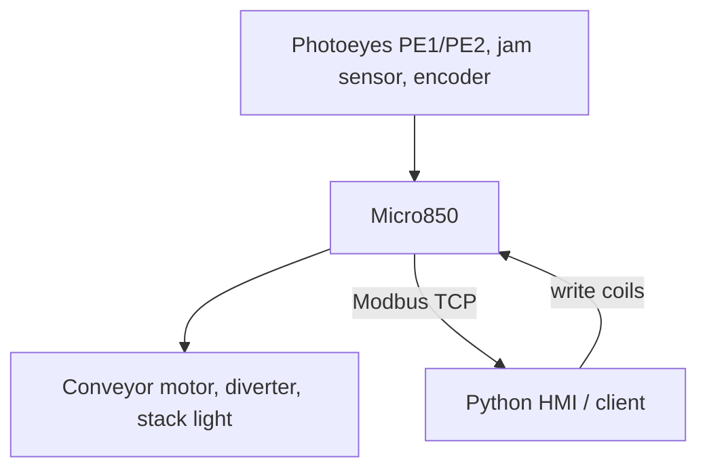

# Architecture

## 1. Overview

## 2. Ladder program organization

| Program | Function |
| --- | --- |
| `PRG_IO_MAP` | Maps physical inputs/outputs to internal bits |
| `PRG_CONVEYOR` | Run/stop, E-stop and jam state machine |
| `PRG_SORT` | Part detection, classification and diverter timing |
| `PRG_COUNTERS` | Production counters and throughput calculation |
| `PRG_MODBUS` | Maps internal bits/registers to Modbus holding registers |

## 3. Simulation equivalence

The Python `ConveyorSimulator` reproduces the same programs and exposes the same Modbus map. External clients and tests use Modbus TCP; the local HMI uses a small HTTP bridge to the same simulator.

## 4. Timing

| Item | Value |
| --- | --- |
| PLC scan | 10 ms typical |
| Simulator tick | 200 ms |
| Belt speed | 10-100 % (default 50 %) |
| Jam detection | PE1 blocked with no encoder pulse for 3 s |
| Diverter pulse | 0.6 s |

## 5. Nota (ES)

El simulador incluye un servidor Modbus TCP real, así que los clientes externos y las pruebas ejercitan el mismo protocolo que se usaría con el Micro850.
